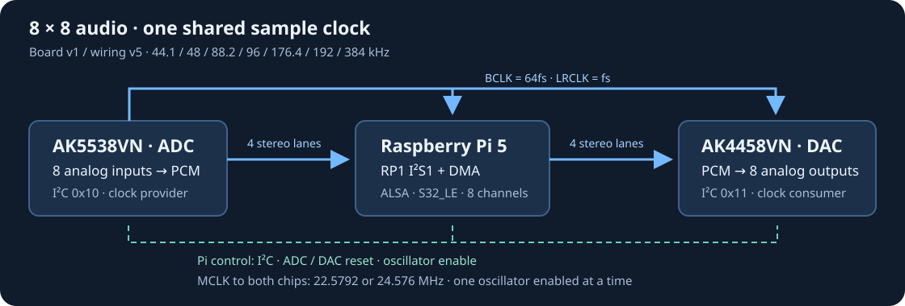

# AK5538VN + AK4458VN audio card for Raspberry Pi 5

**8 inputs · 8 outputs · 44.1–384 kHz · ALSA / ASoC · PREEMPT_RT**

[](COPYING)
[](docs/VALIDATION.md)

[Русская документация](README.ru.md) · [Installation](docs/INSTALL.md) · [Hardware](docs/HARDWARE.md) · [Controls / API](docs/CONTROLS.md) · [Validation](docs/VALIDATION.md)

Linux driver for the **PiAoIP audio card v1**, using the **EasyEDA v5** wiring revision dated **2026-09-30**. One module handles both converters, their shared clocks, reset sequencing and ALSA controls. The Raspberry Pi RP1 I²S controller and the kernel DMA driver carry the audio.

Development version **0.1.2-dev** reduces repeated mute/close waits. Measured ALSA
duplex teardown p50 improved from **208 ms to 38 ms**. See
[profile switching, measurements and Rey Effects integration](docs/PROFILE-SWITCHING.md).
All seven rates, shared clocks and five DAC filters were retested on the Pi.
The earlier 60-second 384 kHz stress report remains historical evidence from 0.1.0.
All five AK4458 filters are available through `akmctl dac-filter`; the default
remains short-delay sharp. Changes require both PCM streams to release parameters.
[Controls / API](docs/CONTROLS.md).



## Capabilities

| Interface | Supported configuration |
|---|---|
| Capture / playback | 8 channels in each direction, simultaneously |
| ALSA device | `hw:PiAoIPAKM,0` |
| PCM format | `S32_LE`, interleaved; 32 bytes per 8-channel frame |
| Sample rates | 44100, 48000, 88200, 96000, 176400, 192000, **384000 Hz** |
| Digital audio | Four stereo I²S lanes per direction; two 32-bit slots per lane; BCLK = 64 × fs |
| Clock roles | AK5538 supplies BCLK/LRCLK; Pi 5 and AK4458 consume them |
| Control bus | I²C1: AK5538 at `0x10`, AK4458 at `0x11` (7-bit addresses) |
| Output controls | Per-channel attenuation and common playback mute |
| Input controls | HPF preference and normal / short-delay sharp filter |
| Tested platform | Raspberry Pi 5, ARM64, `6.18.50+rpt-rpi-v8-rt` |

Capture and playback share **one sample rate**. The raw hardware PCM requires eight channels and `S32_LE`. Applications can perform conversion and routing above ALSA. AoIP transport, a Windows driver and DSP are separate components.

At **384 kHz**, the ADC uses OCT mode: its HPF and digital filter selection are ignored by the chip. See [clock modes and register configuration](docs/HARDWARE.md#clock-modes).

## Quick start

On a Pi 5 running the tested ARM64 kernel, with the matching board connected and powered:

```sh
git clone https://github.com/danrey-bilo/AK5538VN_plus_AK4458VN_audio_card_v1_for_PI5.git
cd AK5538VN_plus_AK4458VN_audio_card_v1_for_PI5
python3 tools/verify_package.py
bash install.sh --prebuilt --check
sudo bash install.sh --prebuilt
sudo reboot
```

The repository's current access settings apply when cloning. Release archives are also suitable for copying to a Pi without Git credentials.

After reboot:

```sh
akmctl mute
akmctl volume 0
akmctl status
arecord -l
aplay -l
python3 /usr/local/src/piaoip-akm-v5/tests/pcm_smoke.py
```

For another kernel, **build against its matching headers**. The prebuilt module is tied to the exact kernel ABI. [Installation](docs/INSTALL.md) covers dependencies, source builds, optional RT setup, backups and uninstalling.

The driver starts with output disabled. A system ALSA state restore can change that preference; use `akmctl mute` before initial tests. Idle status normally reports `powered=0` and `rate=0`: clocks and converters start automatically when a PCM stream is configured.

## Daily use

```sh
akmctl status
akmctl mute
akmctl volume 0
akmctl hpf on
akmctl adc-filter short
akmctl unmute
```

Close both PCM streams before changing ADC filters. The selected DAC output level is applied to all eight channels by the CLI; separate channel values are available through ALSA. [Controls / application API](docs/CONTROLS.md) documents every control, status field and PCM lifecycle.

Record all eight channels for five seconds:

```sh
arecord -D hw:PiAoIPAKM,0 -c 8 -r 48000 -f S32_LE -d 5 /tmp/input.wav
```

Play an eight-channel, `S32_LE` WAV at a supported rate:

```sh
akmctl volume 0
akmctl unmute
aplay -D hw:PiAoIPAKM,0 eight-channel.wav
akmctl mute
```

## What has been verified

The physical prototype passed simultaneous ADC capture and zero-filled DAC playback at all seven rates. A **60-second 384 kHz test transferred 23,040,000 frames per channel in each direction**, with no ALSA XRUN or recorded I²C errors. Shared-clock lifecycle, all eight volume registers, mute readback, filter configuration and automatic boot loading were checked.

**Analog audio qualification remains open:** no known input signal or physical DAC-to-ADC loopback was used. These tests do not establish analog output levels, polarity, channel identity, THD+N, or end-to-end audio latency. The release is a **prototype / prerelease**. [Validation](docs/VALIDATION.md) gives the measurements, exact test conditions, source hashes and remaining tests.

## Documentation

| Guide | Contents |
|---|---|
| [Installation](docs/INSTALL.md) | Packages, RT kernel, exact-ABI binaries, source build, 4 GB microSD, rollback |
| [Hardware](docs/HARDWARE.md) | GPIO/header pinout, all audio lanes, clock tree, rate table, registers |
| [Controls / API](docs/CONTROLS.md) | ALSA PCM contract, CLI, mixer controls, sysfs, application integration |
| [Troubleshooting](docs/TROUBLESHOOTING.md) | Missing card, I²C faults, busy devices, mute, 384 kHz, kernel updates |
| [Validation](docs/VALIDATION.md) | Hardware evidence, XRUN counts, scheduler measurements, qualification limits |
| [Development](docs/DEVELOPMENT.md) | Source layout, build, tests, package generation and CI scope |
| [Русское руководство](README.ru.md) | Установка, подключение, команды и результаты проверки |
| [Changelog](CHANGELOG.md) | Version history |

## License and references

Project source, scripts, overlay and documentation are distributed under **GPL-2.0-only**; see [COPYING](COPYING). The included module is accompanied by its corresponding source. AKM and Raspberry Pi names identify the hardware; this is a board-specific community driver.

Hardware references: [AK5538VN](https://www.akm.com/us/en/products/audio/audio-adc/ak5538vn/), [AK4458VN](https://www.akm.com/us/en/products/audio/audio-dac/ak4458vn/), [RP1 peripherals](https://datasheets.raspberrypi.com/rp1/rp1-peripherals.pdf), and the [Raspberry Pi Linux I²S driver](https://github.com/raspberrypi/linux/blob/rpi-6.18.y/sound/soc/dwc/dwc-i2s.c). Board-specific decisions and the pinned schematic identity are documented in [Hardware](docs/HARDWARE.md).
