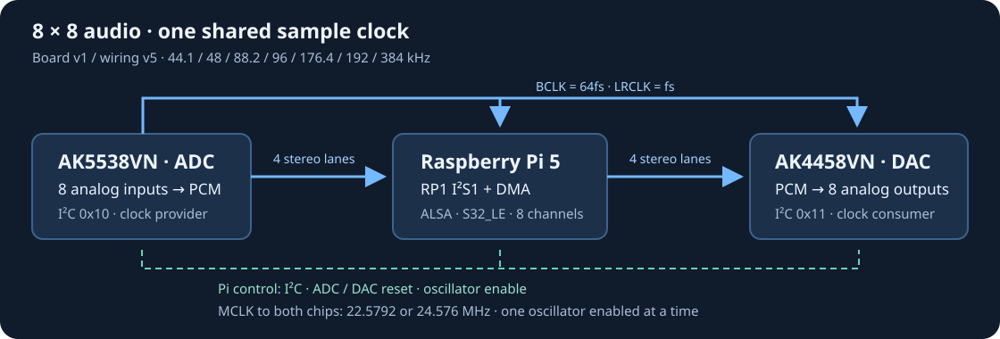

# AK5538VN + AK4458VN — звуковая плата для Raspberry Pi 5

**8 входов · 8 выходов · 44,1–384 кГц · ALSA / ASoC · PREEMPT_RT**

[English](README.md) · [Подключение](docs/HARDWARE.md) · [Установка](docs/INSTALL.md) · [Управление / API](docs/CONTROLS.md) · [Проверки](docs/VALIDATION.md)

Драйвер для **нашей аудиоплаты v1**, соединения которой соответствуют экспорту **EasyEDA v5 от 30.09.2026**. Модуль управляет АЦП AK5538VN, ЦАП AK4458VN, генераторами, сбросом и настройками ALSA. Обмен аудио обслуживает штатный контроллер RP1 I²S1 с DMA.

Версия для разработки **0.1.2-dev** сокращает повторные ожидания mute при закрытии
потоков. Измеренная медиана закрытия двух ALSA-направлений: **208 → 38 мс**.
[Переключение профиля, измерения и интеграция Rey Effects](docs/PROFILE-SWITCHING.ru.md).
На Pi повторно проверены семь частот, общие такты и пять фильтров ЦАП.
Прежняя длительная проверка 384 кГц относится к версии 0.1.0.
Все пять фильтров доступны через `akmctl dac-filter`; режим по умолчанию —
`short-sharp`. Для переключения нужно освободить оба PCM-потока.



## Что поддерживается

| Параметр | Значение |
|---|---|
| Входы / выходы | 8 каналов записи + 8 каналов воспроизведения одновременно |
| ALSA-карта | `PiAoIPAKM` |
| Аппаратное устройство | `hw:PiAoIPAKM,0` |
| Формат | `S32_LE`, 8 чередующихся 32-битных отсчётов в кадре |
| Частоты, Гц | **44100, 48000, 88200, 96000, 176400, 192000, 384000** |
| Синхронизация | Общая частота для записи и воспроизведения |
| Аудиоинтерфейс | 4 стереолинии I²S в каждом направлении; BCLK = 64fs |
| Управление | I²C1: АЦП `0x10`, ЦАП `0x11`; адреса 7-битные |
| Проверенное ядро | ARM64 `6.18.50+rpt-rpi-v8-rt`, PREEMPT_RT |

Это самостоятельный аппаратный драйвер ALSA. Сетевой AoIP, Windows ASIO и DSP подключаются отдельными программами. В этой версии нет DKMS: после изменения ядра модуль нужно пересобрать под его точный ABI.

## Как устроена синхронизация

Один из генераторов платы подаёт MCLK на обе микросхемы: 22,5792 МГц для семейства 44,1 кГц или 24,576 МГц для семейства 48 кГц. Одновременно включается только один генератор.

**АЦП выдаёт BCLK и LRCLK. Raspberry Pi и ЦАП принимают эти такты.** Поэтому даже при одном воспроизведении АЦП остаётся включённым как источник синхронизации. Закрытие записи не останавливает работающий ЦАП.

Каждая из четырёх линий передаёт два канала по 32 бита. Это обычный I²S с четырьмя параллельными стереопарами. Настраивать восемь TDM-слотов и BCLK 256fs для этой схемы нельзя.

При **384 кГц** АЦП работает в OCT mode. Встроенный HPF и выбор цифрового фильтра в этом режиме аппаратно не действуют. Драйвер сохраняет предпочтение для других частот и показывает его применимость в статусе.

## Подключение к Pi 5

Номера GPIO и физические контакты разъёма — разные обозначения.

| Назначение | GPIO | Физический контакт H10 |
|---|---:|---:|
| BCLK от АЦП | 18 | 12 |
| LRCLK от АЦП | 19 | 35 |
| АЦП CH1/2, SDTO1 → Pi | 20 | 38 |
| АЦП CH3/4, SDTO2 → Pi | 22 | 15 |
| АЦП CH5/6, SDTO3 → Pi | 24 | 18 |
| АЦП CH7/8, SDTO4 → Pi | 26 | 37 |
| Pi → ЦАП CH1/2, SDTI1 | 21 | 40 |
| Pi → ЦАП CH3/4, SDTI2 | 23 | 16 |
| Pi → ЦАП CH5/6, SDTI3 | 25 | 22 |
| Pi → ЦАП CH7/8, SDTI4 | 27 | 13 |
| I²C SDA | 2 | 3 |
| I²C SCL | 3 | 5 |
| Сброс АЦП, PDN: физический 0 = сброс | 16 | 36 |
| Сброс ЦАП, PDN: физический 0 = сброс | 17 | 11 |
| Включение генератора 22,5792 МГц | 5 | 29 |
| Включение генератора 24,576 МГц | 6 | 31 |

H10: контакты 2/4 подключены к +5P платы; земля — 6, 9, 14, 20, 25, 30, 34, 39. Контакты Pi 3,3 В (1/17) не соединены с местными регуляторами платы. Подключение питания нужно выполнять по схеме платы: драйвер не проверяет совместимость двух источников питания.

| Каналы ALSA | Входные разъёмы по схеме | Выходные разъёмы по схеме |
|---|---|---|
| 1 / 2 | H1 / H3 | H9 / H11 |
| 3 / 4 | H2 / H4 | H12 / H13 |
| 5 / 6 | H5 / H6 | H17 / H16 |
| 7 / 8 | H7 / H8 | H15 / H14 |

Это порядок из схемы. Фактическое соответствие аналоговых разъёмов и полярность ещё нужно проверить известным сигналом. Все маршруты до выводов микросхем, резисторы, тактовые режимы и таблицы регистров описаны в [Hardware](docs/HARDWARE.md).

## Установка

Для нашей проверенной системы ядро RT уже установлено. На другой системе сначала прочитайте [полную инструкцию](docs/INSTALL.md): там указаны пакеты, выбор RT, сохранение штатного ядра и восстановление.

Получите репозиторий или распакуйте архив релиза на Pi. При закрытом репозитории для клонирования нужен доступ к нему.

```sh
git clone https://github.com/danrey-bilo/AK5538VN_plus_AK4458VN_audio_card_v1_for_PI5.git
cd AK5538VN_plus_AK4458VN_audio_card_v1_for_PI5
python3 tools/verify_package.py
uname -r
```

Если ядро **точно `6.18.50+rpt-rpi-v8-rt`**, можно установить готовый модуль:

```sh
bash install.sh --prebuilt --check
sudo bash install.sh --prebuilt
sudo reboot
```

`--check` только проверяет зависимости, контрольные суммы и версию модуля. Готовый `.ko` нельзя переносить на другой ABI ядра принудительно.

Для сборки под работающее ядро нужны соответствующие headers, GCC/make, `dtc`, Python 3, ALSA utilities и kmod:

```sh
bash install.sh --check
make -j2 all test
sudo bash install.sh
sudo reboot
```

Установщик сохраняет резервные копии в отдельный `/root/piaoip-akm-backup-*`, добавляет overlay и автозагрузку модуля, устанавливает `akmctl` и копирует исходники с документацией в `/usr/local/src/piaoip-akm-v5`. Точный путь резервной копии выводится после установки. Само ядро и настройки RT установщик драйвера не меняет.

После загрузки:

```sh
akmctl mute
akmctl volume 0
akmctl status
arecord -l
aplay -l
```

В простое `powered=0` и `rate=0` — нормальное состояние: микросхемы в сбросе, генераторы выключены. При открытии и настройке PCM драйвер запускает нужный режим автоматически.

Если обычному пользователю недоступны аудиоустройства, добавьте его в группу `audio` и войдите заново:

```sh
sudo usermod -aG audio "$USER"
```

## Управление

```sh
akmctl status
akmctl mute
akmctl volume 0
akmctl hpf on
akmctl adc-filter normal
akmctl adc-filter short
akmctl unmute
```

`volume` задаёт одинаковый уровень всех восьми выходов, от −127,5 до 0 дБ с шагом 0,5 дБ. Нижнее значение соответствует аппаратному mute регулятора. `mute`/`unmute` управляют отдельным общим разрешением воспроизведения.

Выход не включается без работающего playback-потока. При START предусмотрена начальная выдержка 50 мс перед запросом unmute; это не постоянная задержка аудиоданных. При завершении сохраняются такты на время плавного mute, а после освобождения обоих направлений питание микросхем переводится в idle.

**Для изменения HPF и фильтра закройте оба PCM-потока.** Даже остановленный подготовленный поток может удерживать параметры; тогда будет `EBUSY`. При 384 кГц эти фильтры не действуют из-за режима АЦП.

Отдельные уровни каналов через ALSA:

```sh
amixer -c PiAoIPAKM cset name='DAC Playback Volume' 255,255,255,255,255,255,255,255
```

255 = 0 дБ; 231 = −12 дБ; 0 = mute. Программы должны использовать ALSA controls, а не писать напрямую в I²C/GPIO. Нельзя параллельно управлять этими выводами или применять `i2cset -f`.

Настройки не записываются на SD после каждой команды. Для намеренного сохранения через системный ALSA state:

```sh
akmctl mute
sudo alsactl store PiAoIPAKM
```

При загрузке драйвера выход по умолчанию выключен, уровень 0 дБ, HPF включён, короткий фильтр выключен. Системное восстановление ALSA может вернуть ранее сохранённые значения. Поэтому перед первым тестом явно задавайте mute и нужный уровень.

Все имена ALSA controls и значения полей статуса приведены в [Controls / API](docs/CONTROLS.md).

## Приём и передача аудио

Запись всех входов, пять секунд:

```sh
arecord -D hw:PiAoIPAKM,0 -c 8 -r 48000 -f S32_LE -d 5 /tmp/input.wav
```

Воспроизведение восьмиканального WAV соответствующего формата и частоты:

```sh
akmctl volume 0
akmctl unmute
aplay -D hw:PiAoIPAKM,0 eight-channel.wav
akmctl mute
```

В собственном ПО открывайте `hw:PiAoIPAKM,0`, задавайте восемь каналов, `S32_LE` и одну из семи частот. В одном кадре 32 байта. Одновременные запись и воспроизведение должны иметь одинаковую частоту; для её смены сначала освобождайте оба направления.

Пример одновременного приёма/передачи через настоящую `libasound` есть в [tests/pcm_smoke.py](tests/pcm_smoke.py). Там два потока выполнения, неблокирующие ALSA-вызовы, передача нулей и обработка частичных операций. Это функциональный тест с буфером 40 мс, а не готовый движок для минимальной задержки. Порядок настройки нативного приложения описан в [API](docs/CONTROLS.md#application-lifecycle).

## Проверка на плате

```sh
akmctl mute
akmctl hpf on
python3 /usr/local/src/piaoip-akm-v5/tests/pcm_smoke.py
python3 /usr/local/src/piaoip-akm-v5/tests/lifecycle.py
```

Минутный режим 384 кГц:

```sh
python3 /usr/local/src/piaoip-akm-v5/tests/pcm_smoke.py --rates 384000 --seconds 60 --skip-rejections --json-out /tmp/akm-384k.json
```

Тесты передают в ЦАП нули, проверяют цифровой обмен и реальные регистры. Они не создают известный аналоговый тестовый сигнал. Lifecycle временно меняет громкости, mute и фильтр, а в конце возвращает mute, обычный фильтр и уровень −12 дБ.

На физическом экземпляре 15.10.2026:

- Все семь частот прошли одновременный приём/передачу по две секунды.
- 384 кГц, 8×8, 60 секунд: **23 040 000 кадров на канал в каждом направлении**, XRUN = 0, ошибки I²C = 0.
- Проверены восемь регистров громкости, mute/unmute, фильтр, сохранение тактов при закрытии второго направления и автозагрузка.
- При параллельном тесте планировщика p99 составлял 3/5 мкс на CPU0/CPU1, максимум 7/8 мкс за 30 секунд. **Это задержка пробуждения планировщика, не аналоговая задержка АЦП–ЦАП.**

**Аналоговая квалификация ещё не завершена:** не измерены физическая петля, реальные выходные уровни, полярность/соответствие каждого разъёма, THD+N и сквозная задержка. Также предстоят длительные испытания приложения, малых буферов и suspend/resume. Поэтому релиз обозначен как prototype / prerelease. Полные условия и исходные отчёты: [Validation](docs/VALIDATION.md).

## microSD 4 ГБ

После выполненной очистки на нашем экземпляре оставалось около 1,54 GiB свободного места в корневом разделе. Драйвер не выполняет очистку ядра, прошивок или локалей. Для этого нужен отдельный анализ конкретной системы.

При 384 кГц восемь каналов `S32_LE` занимают 12 288 000 байт/с в одном направлении — около 703 MiB за минуту записи. Не сохраняйте длинные записи на маленькую SD. Используйте ограниченный `/tmp`, внешний диск или сеть; `/tmp` тоже ограничен объёмом RAM.

## Отключение и восстановление

```sh
sudo bash /usr/local/src/piaoip-akm-v5/uninstall.sh
sudo reboot
```

Это отключает управляемую автозагрузку платы и сохраняет RT-ядро, исходники и модуль. До перезагрузки уже загруженная карта продолжает существовать. Если overlay добавляли отдельно вручную, уберите и эту строку.

После обновления ядра пересоберите драйвер под его headers. Для проблем с загрузкой можно подключить boot-раздел к другому компьютеру и убрать блок `PIAOIP AKM AUDIO`; возврат с RT отдельно описан в [Installation](docs/INSTALL.md#disable-and-roll-back).

Диагностика отсутствующей карты, занятых устройств, ошибок I²C и XRUN: [Troubleshooting](docs/TROUBLESHOOTING.md). Состав исходников, сборка и контрольные суммы: [Development](docs/DEVELOPMENT.md).

## Лицензия

GPL-2.0-only, полный текст — [COPYING](COPYING). Готовый модуль поставляется вместе с соответствующими исходниками. Версия 0.1.0 относится к указанной плате и проверенному ядру; она не подтверждает работу произвольной разводки или другого ABI.
