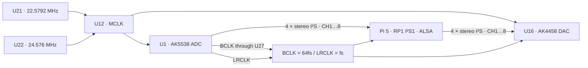

# Hardware interface and codec configuration

[Home](../README.md) · [Application API](CONTROLS.md)

## Supported board identity

| Item | Identity |
|---|---|
| Product name | PiAoIP AK5538VN + AK4458VN audio card v1 for Pi 5 |
| Wiring source | EasyEDA **v5**, project dated **2026-09-30** |
| Schematic export SHA-256 | `32218e21228911098f3cca51d3b827f022edd48c9390866c8f6940cfe198a2c3` |
| U1 | AK5538VN, eight-channel ADC |
| U16 | AK4458VN, eight-channel DAC |
| U21 / U22 | 22.5792 MHz / 24.576 MHz oscillators |
| U12 | Shared MCLK distribution in the board design |
| U27 | BCLK buffer in the board design |
| H10 | Pi 40-pin interface |

The product revision **v1** and schematic-folder revision **v5** refer to different things. The overlay's `v5` name follows the wiring revision. This is a fixed board driver, not a generic driver for arbitrary AKM breakouts. The CAD project is identified by hash; CAD files and third-party datasheet PDFs are not part of this software distribution.

## Audio and clock topology

AK5538 is the serial clock **provider**. The Pi RP1 I²S1 and AK4458 are clock **consumers**. Playback-only operation still needs the ADC running to supply BCLK/LRCLK. Neither PCM direction may switch the common clock while the other direction holds its parameters.

The hardware uses ordinary I²S on **four parallel stereo data lanes** in each direction. Each lane has two 32-bit slots. All lanes share BCLK and LRCLK, so eight channels still require **64fs BCLK**, not 256fs. No eight-slot TDM configuration is used.

There is no direct ADC-to-DAC data connection: monitoring/routing must pass through a Pi application. MCLK comes from the audio board, not from a Pi GPIO clock output.

## H10 / Raspberry Pi pinout

GPIO numbers below are BCM/RP1 GPIO numbers. Physical pins are the 40-pin header positions. Directions are relative to the Pi.

| Signal | GPIO | H10 physical pin | Direction | Board route / role |
|---|---:|---:|---|---|
| BCLK | 18 | 12 | Input | U1 pin 33 → R79 → U27 → R122 → Pi; U27 also feeds DAC pin 2 through R132 |
| LRCLK | 19 | 35 | Input | U1 pin 34 → R82 → Pi; DAC pin 3 connected through R81 |
| ADC SDTO1 | 20 | 38 | Input | U1 pin 36 → R104 (22 Ω), ADC channels 1/2 |
| ADC SDTO2 | 22 | 15 | Input | U1 pin 37 → R103 (22 Ω), ADC channels 3/4 |
| ADC SDTO3 | 24 | 18 | Input | U1 pin 38 → R102 (22 Ω), ADC channels 5/6 |
| ADC SDTO4 | 26 | 37 | Input | U1 pin 39 → R101 (22 Ω), ADC channels 7/8 |
| DAC SDTI1 | 21 | 40 | Output | R143 (20 Ω) → U16 pin 4, DAC channels 1/2 |
| DAC SDTI2 | 23 | 16 | Output | R142 (20 Ω) → U16 pin 5, DAC channels 3/4 |
| DAC SDTI3 | 25 | 22 | Output | R141 (20 Ω) → U16 pin 6, DAC channels 5/6 |
| DAC SDTI4 | 27 | 13 | Output | R140 (20 Ω) → U16 pin 7, DAC channels 7/8 |
| SDA1 | 2 | 3 | Bidirectional | U1 pin 43 and U16 pin 13, I²C control |
| SCL1 | 3 | 5 | Output | U1 pin 45 and U16 pin 14, I²C clock at 100 kHz |
| ADC PDN | 16 | 36 | Output | R105 → U1 pin 28; physical LOW asserts reset |
| DAC PDN | 17 | 11 | Output | R139 → U16 pin 48; physical LOW asserts reset |
| U21 OE | 5 | 29 | Output | R117 → 22.5792 MHz oscillator; physical HIGH enables |
| U22 OE | 6 | 31 | Output | R78 → 24.576 MHz oscillator; physical HIGH enables |

GPIO 18–27 are all assigned to RP1 **I²S1 (ALT4)** by the overlay. GPIO 12 is not the oscillator selector on this revision.

H10 power/reference connections:

| Physical pins | Board connection |
|---|---|
| 2, 4 | Board +5P / Pi 5 V header rail |
| 6, 9, 14, 20, 25, 30, 34, 39 | Ground |
| 1, 17 | Pi 3.3 V pins unconnected to this board's local regulator rails |
| 27, 28 | HAT EEPROM interface unconnected |

These power connections are schematic facts, not authorization to combine independent power supplies. Software does not qualify the board power arrangement.

## PCM channel order

One interleaved frame is `[CH1, CH2, CH3, CH4, CH5, CH6, CH7, CH8]`, eight signed little-endian 32-bit samples. Lane order follows the RP1 controller; there is no driver remapping to numerical H-connector order.

| ALSA channels (one-based) | Lane | ADC connectors by schematic | DAC connectors by schematic |
|---|---|---|---|
| 1 / 2 | SDTO1 / SDTI1 | H1 / H3 | H9 / H11 |
| 3 / 4 | SDTO2 / SDTI2 | H2 / H4 | H12 / H13 |
| 5 / 6 | SDTO3 / SDTI3 | H5 / H6 | H17 / H16 |
| 7 / 8 | SDTO4 / SDTI4 | H7 / H8 | H15 / H14 |

Connector identities above come from the schematic. Actual analog channel identity, polarity and recovery after an XRUN still require a known per-channel signal test.

## Clock modes

| Sample rate, Hz | Oscillator | MCLK, Hz | MCLK/fs | BCLK, Hz | ADC CKS | ADC `0x02`, HPF preference on |
|---:|---|---:|---:|---:|---:|---|
| 44100 | U21 / GPIO5 | 22579200 | 512 | 2822400 | 6 | `0x37` |
| 48000 | U22 / GPIO6 | 24576000 | 512 | 3072000 | 6 | `0x37` |
| 88200 | U21 / GPIO5 | 22579200 | 256 | 5644800 | 3 | `0x1f` |
| 96000 | U22 / GPIO6 | 24576000 | 256 | 6144000 | 3 | `0x1f` |
| 176400 | U21 / GPIO5 | 22579200 | 128 | 11289600 | 0 | `0x07` |
| 192000 | U22 / GPIO6 | 24576000 | 128 | 12288000 | 0 | `0x07` |
| 384000 | U22 / GPIO6 | 24576000 | 64 | 24576000 | 8 | `0x47` |

Only one oscillator is enabled at once; both are disabled between families. The DAC's automatic clock selection is enabled. Unsupported rates are rejected, including 32 kHz, 364 kHz and 768 kHz. 352.8 kHz is not implemented by this version.

At 384 kHz the AK5538 is in **OCT mode**. Its HPF and digital filter selection are ignored by hardware (AK5538 datasheet, printed page 53). Clearing HPF changes the saved/register bit, but does not enable a functioning HPF at this rate. `hpf_effective` and `adc_filter_selectable` report applicability rather than just the saved preference.

## I²C ownership and startup sequence

The module reserves 7-bit addresses `0x10` and `0x11` on I²C1 and uses 8-bit register addresses/data through Linux regmap. It checks every configuration write by reading the register back. Configuration is applied in process context, protected by a mutex; the DMA/PCM trigger callback performs no I²C transactions or sleeping delays.

1. Assert both active-low PDN signals; wait at least 1 ms, then disable both oscillators.
2. Lock the I²C root adapter, enable the selected oscillator and wait 5 ms.
3. Release both PDN signals, then hold the I²C bus lock for a further 20 ms during internal LDO startup.
4. Release the bus lock and write/read back the muted PCM profiles below.
5. Release the ADC's internal reset; wait `ceil(578000 / fs) + 5` ms for initialization/settling.
6. Release the DAC's internal reset. ALSA can then start DMA.
7. A permitted playback stream requests unmute through delayed work, 50 ms after START. This is a startup hold, not a measured steady-state PCM latency.

On playback close, soft mute is requested while clocks remain present. After both directions release their parameters, the driver waits 100 ms for the mute ramp, asserts PDN and disables both oscillators. A remaining stream retains the common clocks. Filter changes are rejected while either direction holds parameters.

Probe performs a muted 48 kHz configuration/readback and then returns the board to idle. The card is not registered if initialization fails.

## Register profiles in version 0.1.0

The tables describe what the shipped source writes; they are not a general-purpose register programming API.

### AK5538VN

| Address | Value | Use |
|---|---|---|
| `0x00` | `0xff` | Enable all eight ADC channels |
| `0x01` | `0x00` → `0x01` | Configure in reset, then run |
| `0x02` | `(CKS << 3) \| 0x06 \| HPF` | Selected clock mode, I²S format and HPF preference |
| `0x03` | `0x00` | Normal PCM profile |
| `0x04` | `0x00` or `0x02` | Normal sharp or short-delay sharp filter |
| `0x05` | `0x00` | Normal PCM profile |

The driver never writes ADC registers `0x06`–`0x1f`.

### AK4458VN

| Address | Value | Use |
|---|---|---|
| `0x00` | `0x8e` → `0x8f` | Automatic clock selection / PCM format; reset then run |
| `0x01` | `0x03` / `0x02`, or `0x23` / `0x22` | Muted / enabled; SD follows the selected DAC filter |
| `0x02` | `0x00` or `0x01` | PCM profile and DAC SLOW selection |
| `0x05` | `0x00` or `0x01` | DAC SSLOW selection; DFS2 remains zero in the automatic-clock profile |
| `0x0a` | `0x0d` | Fixed routing/mode profile |
| `0x0b` | `0x0c` | Fixed routing/mode profile |
| `0x0c`, `0x0d` | `0x00` | Fixed PCM profile |
| `0x0e` | `0x50` | Fixed PCM profile |
| `0x03`, `0x04`, `0x0f`–`0x14` | One 0–255 value per channel | Attenuation; 255 = 0 dB, 231 = −12 dB, 0 = mute |

Reserved/status fields are not overwritten; for example `0x07=0x03` and `0x08=0x00` are retained from reset in the recorded tests. Registers `0x15`–`0x1f` are never written. DSD, daisy-chain and alternative TDM/routing modes are not exposed. This board is operated only in its documented PCM configuration.

Do not use forced userspace I²C writes, raw GPIO commands or a second codec driver while this module owns the board.

## Reference material

- [AKM AK5538VN product / documentation](https://www.akm.com/us/en/products/audio/audio-adc/ak5538vn/) — clock tables, PCM format, reset timing and OCT limitations.
- [AKM AK4458VN product / documentation](https://www.akm.com/us/en/products/audio/audio-dac/ak4458vn/) — clock selection, mute, attenuation and register definitions.
- [Raspberry Pi RP1 peripherals](https://datasheets.raspberrypi.com/rp1/rp1-peripherals.pdf) — GPIO functions and I²S hardware.
- [Raspberry Pi Linux DWC I²S source](https://github.com/raspberrypi/linux/blob/rpi-6.18.y/sound/soc/dwc/dwc-i2s.c) — CPU DAI and DMA behavior.

The rate policy and actual initialization are in [akm_v5_config.h](../akm_v5_config.h) and [piaoip_akm.c](../piaoip_akm.c).
